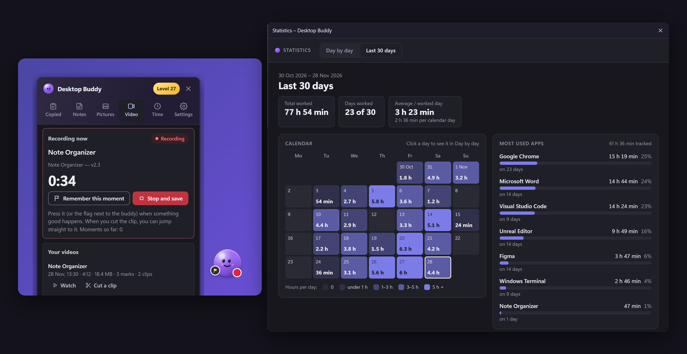
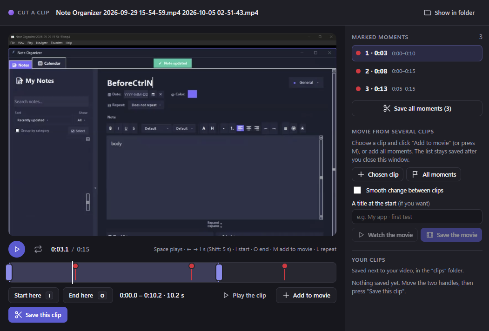
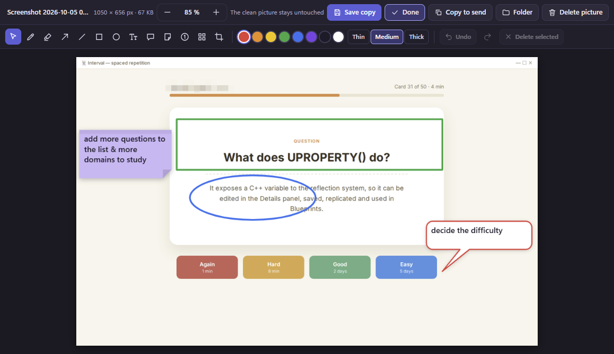
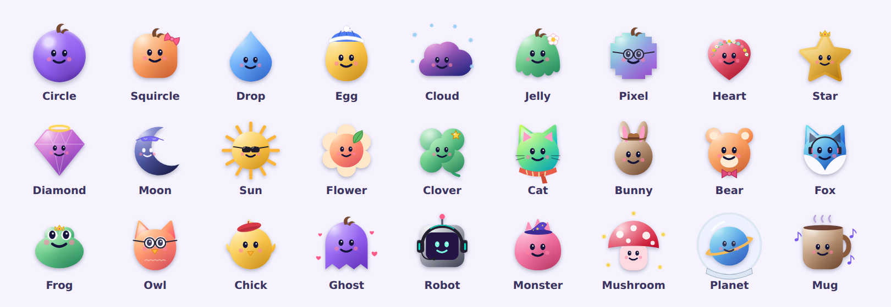

<p align="center"></p>

<h1 align="center">Desktop Buddy</h1>

<p align="center">
  <b>A small Windows companion that records only the app you are testing, starts and stops by itself,
  and turns the run into short MP4 clips for a portfolio.</b><br>
  Plus focus sessions with statistics, notes with reminders, a clipboard history that skips secrets,
  and screenshots you can draw on. Works offline.
</p>

<p align="center">
  <a href="docs/FEATURES.md">All features</a> ·
  <a href="docs/ENGINEERING.md">Engineering</a> ·
  <a href="docs/qa/Desktop-Buddy-Test-Cases.xlsx">Test plan</a> ·
  <a href="docs/DECISIONS.md">Decisions</a> ·
  <a href="CHANGELOG.md">Changelog</a>
</p>



| | |
|---|---|
| **What** | Desktop app for Windows 10/11 · Electron 44, vanilla JavaScript (no framework, no bundler) · MIT |
| **My role** | Product idea, UX and visual design, feature specs, QA (72 test cases, defect log) and the audits. The code was written in pair-programming with an AI assistant (Claude): see [How it was built](#how-it-was-built). |
| **Quality** | 295 unit tests · ESLint + CI on Windows (GitHub Actions) · 72 test cases, all passed (48 run by hand on Windows, 24 automated) · three audit rounds, ~145 issues fixed (the last round found no critical or high issues) |
| **Status** | v1.16.2 · English UI with a beginner **simple mode** and a first-run tour · not code-signed, so SmartScreen asks once |

## Why it exists

My apps are often **tested by an AI agent** that opens them, clicks around and closes them, dozens of times in a row. Those runs are great demo material, but screen recorders film the whole screen, have to be started and stopped by hand on every relaunch, and leave one long video where the good 10 seconds are hard to find.

Desktop Buddy fixes that: tell it *"record any window whose title contains **Note Organizer**"* and it **starts by itself** when the window appears, **stops** when it closes, **joins quick relaunches** into one file, **skips idle parts**, lets you **mark good moments with one click**, and cuts the result into short MP4 clips.

## Highlights

- **Window recorder**: one window only (no desktop, no notifications), auto start/stop by window title, crash-safe files.
- **Clip editor**: timeline with your marked moments, in/out handles, and a **movie from several clips** with fades and a title, all without ffmpeg.
- **A buddy that grows**: 27 shapes and 72 rewards unlocked by focused work (XP from timer minutes, daily streaks).
- **Everyday tools**: timer with statistics, notes with checklists and reminders, screenshots with drawing tools and blur, send-only email.



<p align="center">
  
  
</p>

More pictures and every feature in detail: **[docs/FEATURES.md](docs/FEATURES.md)**.

## Engineering in short

- **Recording a window that closes and reopens stays one video**: the window is drawn onto a canvas and the canvas is recorded, so a new window stream is swapped in underneath without `MediaRecorder` noticing.
- **Clips without ffmpeg**: the range is replayed and re-encoded in real time with `MediaRecorder`, so the installer stays small.
- **Data never lost**: atomic saves with fsync, a backup of the last good version, and a file the app can't read is never overwritten.
- **Secure by default**: sandboxed pages with a strict CSP, IPC accepted only from the app's own windows, secrets encrypted with Windows DPAPI, and **no network except sending email** (a test fails on any other network call).
- **Built for weak PCs**: a power saver for 4 GB / dual-core machines, no endless animations, the buddy shows up first.
- **A live demo from the same code**: the app's real pages also run in a browser. A small stand-in replaces the Electron preload, and the app's own logic modules (sessions, XP, notes, the secret filter, settings validation) are bundled as they are, so the demo can't drift from the app.

The hard problems, security, tests and code layout: **[docs/ENGINEERING.md](docs/ENGINEERING.md)** · design notes: [docs/ARCHITECTURE.md](docs/ARCHITECTURE.md).

## Getting started

Windows 10/11 and **Node.js 20+**:

```bash
npm install      # Electron, electron-builder, nodemailer
npm start        # run in development
npm run demo     # run on 30 days of made-up data (for screenshots; real data untouched)
npm run site     # build the presentation page + the live web demo into site/ (for Netlify)
npm test         # 295 unit tests
npm run lint     # ESLint (also runs in CI before the tests)
npm run dist     # build the installer: dist/Desktop Buddy Portfolio Setup 1.16.2.exe
```

On a Windows machine without Developer Mode (or admin rights), 3 of the 295 tests fail with `EPERM`: they create a symlink to check that the app refuses it, and Windows doesn't let them create one. CI on GitHub's Windows runner can, and passes all 295.

The installer isn't code-signed: SmartScreen asks once (*More info → Run anyway*). To record, open the **Video** tab → *Record a window*.

## How it was built

I own the product: I picked the problem (filming AI test runs of my own apps), wrote the requirements, made the UX calls and tested on Windows. Some of those calls: match windows by **title** (every Python app shows up as "Python"), **remove GIF export** after its text proved unreadable, **remove the spellchecker** because Electron downloaded dictionaries and broke the offline rule, and **remove an unfinished AI tab** rather than ship a placeholder.

The code was written in pair-programming with Claude (Anthropic's AI assistant). Before release I ran **two rounds of adversarial audits** (and a third, confirmation round that found no critical or high issues) with parallel AI reviewers (robustness, media, security, performance on a 4 GB / HDD PC, code review, hiring-manager and beginner views). They found about 140 issues, from data loss when antivirus locks a file to a recording that could end up empty; each fix came with a test. Then I wrote and ran a **manual test plan** on Windows ([72 test cases and a defect log](docs/qa/Desktop-Buddy-Test-Cases.xlsx)).

## License

[MIT](LICENSE) © 2026 Desktop Buddy
