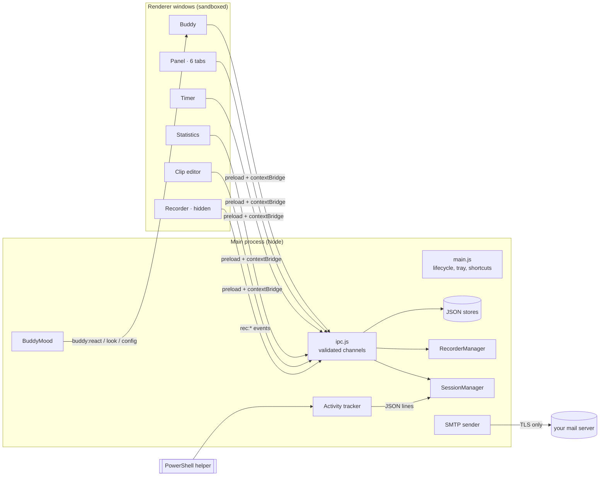
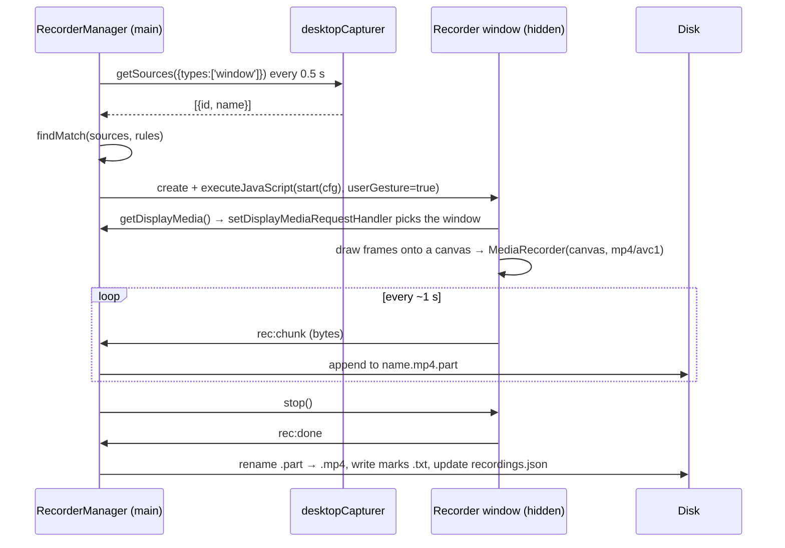
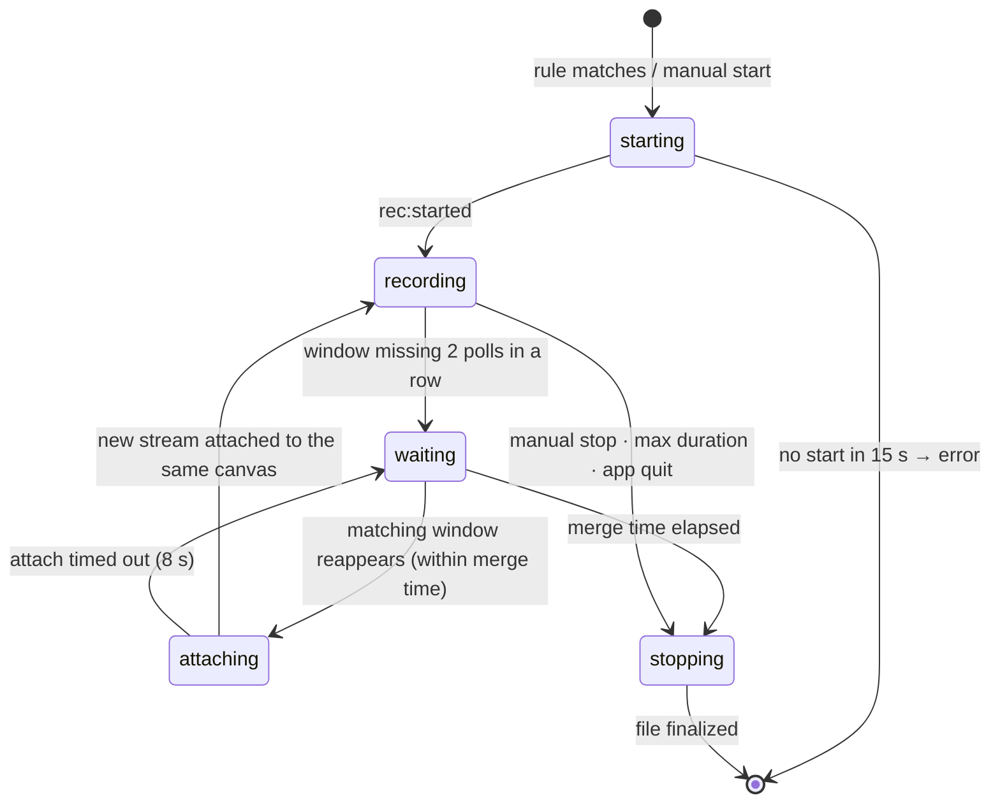
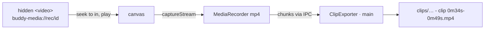
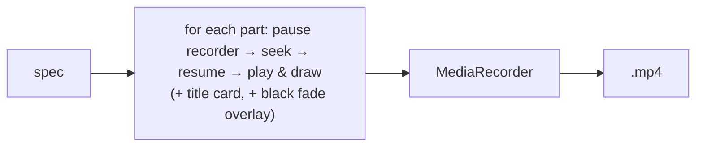
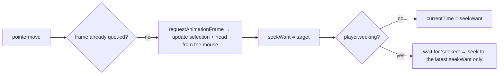
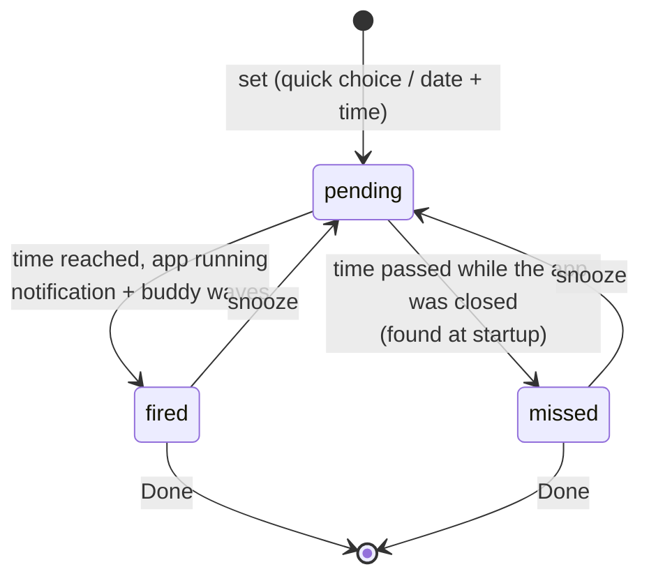
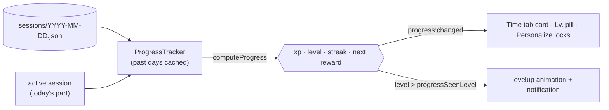
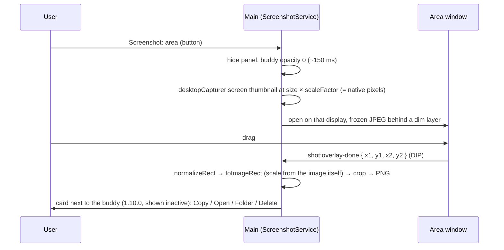
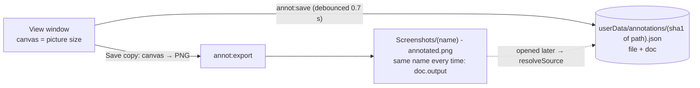

# Architecture

How Desktop Buddy (Portfolio Edition) is put together, and why. For the feature overview see [FEATURES.md](FEATURES.md) and the [README](../README.md); the main engineering problems are summed up in [ENGINEERING.md](ENGINEERING.md). The decisions and their reasons are in [`DECISIONS.md`](DECISIONS.md); releases are in [`CHANGELOG.md`](../CHANGELOG.md).

## Contents

1. [Process model](#1-process-model)
2. [Security boundary](#2-security-boundary)
3. [Storage](#3-storage)
4. [Window recorder](#4-window-recorder)
5. [Marks and the clip editor](#5-marks-and-the-clip-editor)
6. [Sessions, app tracking and statistics](#6-sessions-app-tracking-and-statistics)
7. [The buddy: mood and look](#7-the-buddy-mood-and-look)
8. [Email (send only)](#8-email-send-only)
9. [Text tools, checklists and reminders (and why there's no spellcheck)](#9-text-tools-checklists-and-reminders-and-why-theres-no-spellcheck)
10. [A buddy that grows](#10-a-buddy-that-grows)
11. [Two editions, one codebase](#11-two-editions-one-codebase)
12. [Testing strategy](#12-testing-strategy)
13. [Quick capture: quick note and screenshots](#13-quick-capture-quick-note-and-screenshots)
14. [Reliability: what happens when things go wrong](#14-reliability-what-happens-when-things-go-wrong)
15. [Simple mode, first-run tour, power saver](#15-simple-mode-first-run-tour-power-saver)

---

## 1. Process model

One **main process** owns all state, all files and all OS access. Pages are thin views that talk to it through a **preload bridge**.



| Window | Type | Notes |
|---|---|---|
| **Buddy** | frameless, transparent, always on top | custom drag with a 4 px click/drag threshold (`-webkit-app-region: drag` would swallow clicks); a 14 px transparent margin leaves room for the waving hand, the Zzz and hair or hats |
| **Panel** | frameless, created once, shown/hidden | opens on the side of the buddy that has room; tabs: Copied, Notes, Pictures, **Video**, Time, Settings |
| **Timer** | frameless, always on top | exists only while a session exists; position validated against current displays |
| **Statistics** | normal window, single instance | Day by day + Last 30 days |
| **Clip editor** | normal window, single instance | `backgroundThrottling: false`, so export keeps running in the background |
| **Quick note** (1.8.0) | frameless, transparent, next to the buddy | Enter saves a new note, Esc discards, blur keeps the text |
| **Screenshot area** (1.8.0) | frameless, covers one display, always on top | shows the frozen capture, you drag an area |
| **Screenshot window list** (1.8.0) | normal window | open windows with thumbnails |
| **Screenshot grabber** (1.8.0) | **hidden**, partition `shot` | takes one frame from the chosen window with `getDisplayMedia` |
| **Screenshot card** (1.10.0) | frameless, transparent, next to the buddy, shown **inactive** | the picture just taken: Copy to send / Draw on it (Open / Folder / Delete under More); closes after 15 s in simple mode, 8 s in full mode (paused on hover) |
| **Screenshots gallery** (1.12.0) | normal window | every screenshot by day, search, filter, select + delete, drag out, drop in from the PC |
| **Screenshot view** (1.10.0) | normal window, sized to the picture | fit or 100 % (real pixels ÷ `devicePixelRatio`), Copy / Folder / Delete |
| **Loop viewer** (1.6.0) | normal window, single instance, black background | plays one clip in a loop for demos; gets the clip by id, never by path |
| **Recorder** | **hidden**, one per recording | separate `recorder` session partition, `backgroundThrottling: false`, destroyed when done |

## 2. Security boundary

- Every window: `contextIsolation: true`, `sandbox: true`, `nodeIntegration: false`, strict CSP (`default-src 'self'`, no inline scripts, no `eval`), no external resources.
- **All IPC goes through two wrappers** (`handle` / `on`) that reject any message whose sender is not the **top frame** of one of the app's own pages under `src/renderer/`. Recorder events (`rec:*`) are accepted **only** from the hidden recorder window.
- Every payload is validated (types, lengths, known ids, date format `YYYY-MM-DD`). Settings pass through `sanitizePatch`, which drops unknown keys and fields that pages are not allowed to set (the recordings folder, encrypted secrets).
- **Files are addressed by id**, never by path: the editor asks for `buddy-media://rec/<id>`, the main process looks the id up in its own index, and only then touches the disk.
- The email password is encrypted with `safeStorage` (DPAPI on Windows), **never crosses into a renderer** (pages get `{ saved }`), and is **bound to the server**: changing host, port, security or username clears it, so a typo can't send it to another server. There is no plain-text fallback when encryption is unavailable.
- **Permissions are denied by default** on every session (geolocation, camera, microphone, notifications, clipboard-read…); only the recorder's desktop capture is allowed. The spellchecker is off on every session.
- **Electron fuses** in the packaged build: no `RunAsNode`, no `NODE_OPTIONS`, no `--inspect`, asar integrity checked, app loaded only from the asar.
- **Pages never receive file paths**: folders are shown as short labels, index items are sent as a fixed list of fields, and `buddy-media://` serves only regular files inside their folder (symlinks and junctions are refused).
- **Offline guard**: a test scans all of `src/` and fails on any network API outside the SMTP email module.
- The PowerShell helper runs by **full path** with the script in `-EncodedCommand`, so there is no `.ps1` on disk to tamper with.
- The clipboard watcher drops anything that matches `SECRET_PATTERNS` (API keys, tokens, JWTs, private keys) or carries the Windows *exclude from monitoring* flag used by password managers.

## 3. Storage

Plain JSON in `%APPDATA%\Desktop Buddy Portfolio\`. There's no database, because the data is small and human-readable files are easy to debug and back up.

| File | Content |
|---|---|
| `settings.json` | settings, window positions, encrypted secrets |
| `clipboard.json`, `notes.json` | clipboard history, notes (each note may carry one reminder) |
| `active-session.json` | the running session, saved on every change and every 15 s |
| `sessions/YYYY-MM-DD.json` | finished sessions of that day, with **aggregated** time per app and per window title |
| `recordings.json` | index of recordings and clips (file, duration, marks, parent recording) |

**`JsonStore`** writes atomically (`file.tmp` → fsync → `rename`), keeps the previous good version as `.bak`, debounces writes (~300 ms; notes also save at least every 5 s while typing) and forces data to disk at most every ~30 s except on stop, sleep and quit; a write that skipped the fsync gets a one-shot catch-up fsync when the 30 s are over, so the last change never stays unsynced. A corrupt file is kept as `*.corrupt-<date>.json` (at most 2) and the app recovers from `.bak`. **A file it can't read** (locked by antivirus or OneDrive) is never treated as empty: the store goes read-only for that run instead of overwriting real data, and the user gets one notice.

## 4. Window recorder

### Capture pipeline



- **Why a hidden window?** `MediaRecorder` and `getDisplayMedia` are browser APIs, so they need a renderer. Keeping it hidden and separate means a crash there doesn't take the UI down.
- **Why `executeJavaScript(…, true)`?** `getDisplayMedia` requires a user gesture. The `true` flag runs the call as if the user had clicked.
- **Format**: `video/mp4;codecs=avc1` is supported by `MediaRecorder` in Chromium 152 (verified), with WebM as fallback. File names are made Windows-safe (reserved characters and names such as `CON` are handled).
- The app's **own windows are excluded** (`/desktop buddy/i`), which avoids a feedback loop.

### State machine



- **Merge relaunches.** In `waiting`, the `MediaRecorder` is paused and the file stays open. If a window matching the same rule (or the same title, for manual recordings) appears within `recMergeSec` (default 15 s), its stream is attached to the **same canvas** and recording resumes in the **same file**. Because the recorder records the canvas and never the window stream, swapping sources is invisible to `MediaRecorder`. The canvas keeps the first window's size and later windows are letterboxed into it.
- **Manual stop is respected.** A window that was stopped by hand won't be auto-recorded again until it closes.
- **Quitting the app** stops and saves any recording in progress.

### Skip idle

`idle.js` (pure, unit-tested) downsamples each frame to **96×54 grayscale** and compares it with the previous one. A change must exceed a small pixel-count threshold, so a blinking caret doesn't count. After *N* seconds without change (0.5–5, configurable) the `MediaRecorder` is paused, and it resumes on the first real change. Elapsed time in the UI and the mark timestamps use **video time** (pauses excluded).

## 5. Marks and the clip editor

### Marks

- A mark comes from a **flag next to the buddy** (shown only while recording; `buddy:mark` → `recorder.mark()`), from *Remember this moment* in the Video tab or from the tray. There is **no global shortcut** since 1.16.0: Ctrl+Shift+F9 failed on real laptops and a global key can be stolen from the app under test. Two marks less than 1 s apart count once.
- Each mark stores the video time. On save, the recording gets `marks` in the index plus a text file `… - marks.txt` with the suggested range per mark (8 s before, 7 s after).

### Serving video to the editor: `buddy-media://`

```
protocol.registerSchemesAsPrivileged([{ scheme: 'buddy-media',
  privileges: { standard, secure, stream, supportFetchAPI, corsEnabled } }])
```

- `buddy-media://rec/<id>` → the main process resolves the id in `recordings.json`. Unknown ids get a 404.
- **Range requests** (`Range: bytes=…` → `206 Partial Content`) let the `<video>` element seek without loading the whole file.
- **CORS matters.** Drawing a cross-origin video onto a canvas without CORS **taints** the canvas, and `captureStream()` from a tainted canvas yields nothing, which made the first export version produce 0-byte clips. The fix is `corsEnabled` on the scheme, `Access-Control-Allow-Origin: *` on responses, and `crossorigin="anonymous"` on the `<video>`.

### Export without ffmpeg



The trade-off is explicit: export runs in **real time** and is accurate to ~0.1 s, but it adds **zero dependencies** and the installer size doesn't change. Exports run in a queue with progress. Ranges are validated to 0.5 s – 10 min, and clips are indexed with `clipOf` so the Video tab can show them under their parent recording.

### Montage, loop playback and scrubbing

Every export is a **spec**: `{ parts: [{ start, end }], format: 'mp4', montage?, title?, fade? }`. A clip is a one-part spec. `shared/montage.js` (UMD, pure, tested) holds the rules used by both sides, and `ClipExporter.begin` runs `checkExport` again in the main process: 1–30 parts, each 0.5 s – 10 min, total ≤ 10 min, title (≤ 60 chars, one line) and fade only for montages. Any other `format` is rejected.



- **Fades**: `fadeAlpha({ i, u, partMs, count, fade, hasTitle })` gives the black overlay opacity: 0.3 s out at the end of every part but the last, 0.3 s in at the start of every part but the first (or after the title), never more than half a part.
- **Preview** (1.5.0): *Play montage* drives the main player through the parts (seek → play → next part when `currentTime ≥ end`) from the editor's `requestAnimationFrame` loop; the title card and fades are an overlay `div` whose opacity comes from the same `fadeAlpha` used by the exporter, so the preview matches the file. Parts are also drawn on the timeline.
- **Montage state**: `editor:montage-get` / `editor:montage-set` store `{ parts, fade, title }` on the parent recording in `recordings.json`, normalized with `normalizeMontage` (unknown values, including the old `gifSize`, are dropped; out-of-range parts removed). *All marks* uses `mergeRanges` so overlapping mark windows become one part.
- Outputs go to `clips/` (old clips in `clipuri/` still play) as `… - clip 0m34s-0m49s.mp4` or `… - montage 3 parts 0m42s.mp4`, indexed with `format`, `kind` and the part count.
- **GIF export was removed in 1.6.0** (it existed in 1.4–1.5 with the vendored gifenc encoder). At sizes where UI text stays readable, GIFs were several MB and still looked worse than a far smaller MP4. GIFs made by older versions stay in the list and open with the system player.

**Loop playback (1.6.0).** In the editor, the loop toggle (**L**) sets `video.loop` for normal playback; for *Play selection* and *Play montage*, the same rAF tick that detects the end seeks back to the start instead of pausing. Finished clips open in a **viewer window** (`renderer/viewer/`, its own preload exposing only `info`, `showFile` and a load event). The main process keeps the item **id**, never a path: `editor:play-loop(id, size)` checks the id in the index, sizes the window to the video (≤ 90 % of the work area) and reuses a single viewer; `viewer:info` returns the `buddy-media://` URL for that id. CSP: `media-src buddy-media:` only.

**Code for a site (1.6.0).** MP4 has no "loop forever" flag (GIF had one in its NETSCAPE extension), so looping on the web is the `<video>` tag's job. `editor:web-embed(id, size)` copies the clip to `clips/for web/<slug>.mp4` (`recorder/web-embed.js`: NFD-stripped, lowercase, `[a-z0-9-]`, ≤ 80 chars; a same-size copy is reused, a different file with the same slug gets `-2`), writes the `<video src="videos/<slug>.mp4" width height autoplay loop muted playsinline>` snippet to the clipboard (attributes HTML-escaped) and reveals the file. `muted` + `playsinline` are what browsers require for autoplay. Verified: the snippet autoplays and loops in Chromium.

**Scrubbing (1.6.0).** The handles used to freeze because every `pointermove` assigned `currentTime`, and each seek on an MP4 with ~3.4 s between keyframes decodes up to a few seconds of video. Now:



The playhead is drawn from the requested time while a seek is pending, so the UI never waits for the decoder. Recorder and exporter pass `videoKeyFrameIntervalDuration: 1000` to `MediaRecorder` (verified with ffprobe: keyframes every ~1.0 s), so each seek decodes at most one second.

## 6. Sessions, app tracking and statistics

- **Sessions** (`sessions.js`, pure) model start/pause/resume/stop as **segments**. Active time is the sum of the segments. A session crossing midnight is **split across both days**, so daily totals are correct. After a crash, the session comes back **paused**, with time up to the last save.
- **App tracking** avoids native modules. `activity/helpers.js` writes a small PowerShell script (`GetForegroundWindow`, `GetWindowText`, and the executable's description as the app name) that prints one JSON line every 1.5 s. It runs **only while a session is active and not paused**, and it's restarted up to 3 times on failure. `usage.js` aggregates the time: each tick is capped at 5 s so sleep doesn't inflate totals, and titles are capped at 300 per day. On macOS the same contract is implemented with `osascript` (untested).
- **Statistics** (`stats.js`, pure) build both views from the day files:
  - `summarizeDay` gives the timeline segments, the sessions table and the apps. Malformed records are skipped, not fatal.
  - `rangeSummary(today, getDay, 30)` gives the calendar cells, the most used apps and the weekly comparison. Weeks run Monday–Sunday. The **current week is compared with the same weekdays of the previous week**, which is fair on a Wednesday. Date math works on local calendar days, so DST changes don't break it.
- Chart colors were validated for contrast and color-vision deficiency. The heatmap uses one hue in 4 steps, and cell text switches between light and dark to keep ≥ 4.5:1 contrast.

## 7. The buddy: mood and look

### Mood: decided in main, drawn in the page

The buddy page only toggles CSS classes on `#stage` (`st-sleep`, `st-think`, `do-wave`, `do-happy`, `do-wow`, `do-yawn`, `blink`, `dragging`). **What** it should do is decided in the main process by `BuddyMood` (`buddy-mood.js`), which gets everything it needs injected (a `send` function, idle time, cursor, window bounds, whether a session runs), so it runs in unit tests without Electron.

| Behavior | Rule |
|---|---|
| **Sleep** | animations on **and** no running session **and** `powerMonitor.getSystemIdleTime() ≥ 180 s`, checked every 5 s. Wakes on hover or click, when the panel opens or when a session starts. |
| **Gaze** | every 120 ms while visible: the cursor's direction from the buddy's center, clamped to [-1, 1] and rounded to 0.1, **sent only when it changes**. The page moves the pupils with `--lx` / `--ly`, and the eye shine an extra ×0.7 so the direction reads clearly. |
| **Reactions** | wave on start; happy on session start/stop, every full hour and after an email is sent; "wow" on new clipboard text (at most every 3 s). Nothing is sent while asleep, and nothing at all when animations are off. |

IPC: `buddy:ready`, `buddy:woke`, `buddy:demo` (Settings → *See the animations*), and towards the page `buddy:react`, `buddy:look`, `buddy:config` (`{ animations, look }`).

### Look: one module, three places

`src/shared/buddy-look.js` is a UMD module used by Node (settings validation) and by pages (drawing):

- **Options**: palettes (plus a custom color), eyes, mouths, cheeks, hairstyles, hair colors and accessories. Accessories have **slots** (face, side, top), and `toggleAccessory` replaces whatever is in the same slot.
- **`normalizeLook`** turns any saved value into a valid look (unknown values fall back to the default, custom colors must be `#RRGGBB`). **`colorsOf`** builds the gradient and switches the face ink to a light color on very dark bodies.
- **Drawing** (`build` + `apply`) uses `createElementNS`: the face is a 64×64 SVG at 74 % of the body, and hair and accessories are a 100×100 overlay that may spill into the transparent margin. The same code draws the desktop buddy, the large preview and every option tile.
- The CSP forbids `style` attributes, so colors are set through CSSOM (`el.style.setProperty`), never as markup.

### Shapes (1.9.0)

`src/shared/buddy-shapes.js` (UMD, loaded before `buddy-look.js`) holds **27 shapes**. Each one is data plus small drawing functions, all in a 100×100 box:

| Field | Meaning |
|---|---|
| `face: [cx, cy, s]` | where the middle between the eyes goes and how much the face scales; the circle is `[50, 45.4, 1]` (no change) |
| `top: [x, y, s]`, `side: [dx, dy]`, `neck` | where hats/hair, side accessories (bow, flower, star, leaf) and the neck slot (bow tie, scarf) move to. On animals `top` is **between the ears**. |
| `hair`, `beak`, `ink`, `cheeks`, `temples` | hide the hair (ears, petals, rays already take that place), beak instead of mouth (owl, chick), fixed face color (robot screen), no cheeks, glasses without arms (frog) |
| `under` / `body` / `over` | SVG nodes: behind the body (ears, handle), the body itself, details on top (belly, spots, visor) |

- **Drawing**: the circle stays the old CSS body, so every look saved before 1.9.0 renders exactly as before. Any other shape adds an SVG layer (`.bl-shape`) under the face and makes the div transparent (`.shaped`). `draw()` builds a 3-stop gradient whose stops use CSS classes bound to `--buddy-a / --buddy-c / --buddy-b` (palette changes need no redraw), clips a highlight and a shade to the body, and gives every `<defs>` id a unique suffix because many mini-buddies share one page.
- **Placing things**: the face moves with CSS variables (`--face-tx`, `--face-ty`, `--face-s`, percentages of the 74 % face box); hair and accessories are wrapped in one `<g transform>` per slot, computed from the shape. The astronaut helmet is never moved (it wraps the whole body) and effects (`fx`) stay around the whole buddy.
- **Unlocks**: `lockedAt` / `lockLook` include `shape` (fallback: circle). In *Personalize* the mouth and hair tiles are drawn on a circle when the chosen shape has a beak or no hair, with a one-line note, so you still see what you pick.
- **Checked visually**: a gallery page renders every shape with every slot filled (crown + bow + bow tie + glasses, hat + flower + scarf + sunglasses, headphones), plus the real buddy window (108 × 108 px with a 14 px margin) for effects that spill out, which is why the rainbow arc wraps around the head instead of sitting above it.

## 8. Email (send only)

- **What is sent**: a note (to any 1–5 addresses, with the last 6 recipients remembered), the 30-day summary, and optionally the session report on Stop. Content is plain text built by `email/compose.js`; subjects are forced onto one line, so a session title can't inject headers.
- **How**: `nodemailer` in the main process, injected as `createTransport` so tests use a fake. `transportOptions` sets `secure: true` for 465 and `requireTLS: true` for 587 (no plain-text fallback), `tls.minVersion: 'TLSv1.2'`, connection/greeting/socket timeouts, and `disableFileAccess` / `disableUrlAccess` so a message can never attach local files or fetch URLs.
- **Password**: encrypted with `safeStorage`, decrypted only right before connecting; pages only see `{ saved }`. Errors are mapped to clear messages (Gmail needs an app password, host not found, port refused, TLS failed, recipient refused, rate limit) without the password or the raw server reply.
- **No IMAP**: reading mail would mean access to the whole inbox, and the app only needs to send.

## 9. Text tools, checklists and reminders (and why there's no spellcheck)

### Spellcheck (removed in 1.6.0)

1.2.0 added a spellchecker on the assumption that Electron, like Chrome, uses the **Windows spellchecker** for languages installed in Windows. Testing on Windows disproved it: with `en-US` installed and spellchecking enabled in Windows, Chromium still fired `spellcheck-dictionary-download-begin` for `en-US`. The Electron docs confirm that on Windows and Linux the checker is **powered by Hunspell dictionaries downloaded from a Google CDN**. The options were bundling `.bdic` dictionaries in the installer or allowing a one-time download from Google (breaking the "network only for email" rule); the owner chose to **remove the feature** instead. Now:

- No window has `spellcheck: true`; `main.js` calls `session.defaultSession.setSpellCheckerEnabled(false)` and still points `setSpellCheckerDictionaryDownloadURL` at a closed local port (`http://127.0.0.1:9/…`) as a guard. A test checks both.
- The old `spellMode` setting is dropped by `sanitizePatch` / `withDefaults`; the old *Proofing* settings category and the `spell:*` IPC channels are gone.
- **Right-click menu**: the panel's `context-menu` event is turned into a native menu from `contextMenuModel(params)` (`src/main/context-menu.js`, pure, tested): undo/redo/cut/copy/paste/select all with the page's `editFlags`, and, in a textarea, *Transform* and *Clean up text*, sent to the page as `text:command`.

### Word count, transforms, clean-up

`src/shared/text-tools.js` (UMD, used by the page and by tests):

- **`textStats`** counts words with a Unicode regex that keeps `într-o`, `n-am`, `e-mail` as one word; reading time is 200 words/minute. Labels use English plurals (1 word, 2 words).
- **Transforms** use `toLocaleUpperCase('ro-RO')` / `toLocaleLowerCase('ro-RO')`; Title Case capitalizes whole words, Sentence case capitalizes the start, each line and after `. ! ?`.
- **`cleanText`** masks URLs, emails and Windows paths, runs 7 counted rules in order (cedilla → comma-below, trailing spaces, space before punctuation, missing space after `,`/`;`, double spaces, extra blank lines, capital after a full stop with an abbreviation list and exceptions for single letters, numbers and `...`), then restores the masked parts. Running it twice finds nothing the second time.
- The page shows the result with `text-diff.js` (word LCS diff; whitespace-only changes drawn as `·` / `↵`) and applies it with `document.execCommand('insertText')`, which keeps the native undo stack.

### Checklists and reminders (1.7.0)

**Checklists stay plain text.** A list line is `[ ] item` / `[x] item` (optionally `- [ ]`, indented), so a note can still be searched, emailed and read anywhere. `src/shared/checklist.js` (UMD, pure, tested) does the work: `toggle(text, selStart, selEnd)` adds boxes to lines that have none, otherwise checks all touched boxes (or unchecks them if all were checked) and returns the replaced range; `onEnter` continues a list (same indent and bullet, unchecked) and ends it on an empty item; `boxAt` detects a click **between the brackets** (not at the line start, so placing the cursor there doesn't toggle); `count` feeds the `2/5` chip in the list. Every edit goes through `execCommand('insertText' | 'delete')`, so **Ctrl+Z** undoes a toggle like typing.

**One reminder per note**, stored on the note: `remind: { at, status: 'pending' | 'fired' | 'missed', firedAt? }`. `at` is an absolute timestamp, so DST changes don't move it; `shared/reminder-time.js` formats it (`azi la 15:00`, `mâine la 09:30`, `vineri, 9 oct. la 15:00`) and builds the quick choices and snoozes. The main process validates every set (`notes:set-reminder`: future, at most 2 years ahead) and owns the clock:



- `ReminderScheduler` (`src/main/reminders.js`, injectable clock and timers, tested) arms **one timer on the next reminder** (capped at 15 s as a safety net) and re-checks on `powerMonitor` `resume`, so a laptop that slept still rings late, with "trebuia la …" in the notification. At startup, anything more than a minute overdue becomes **missed** and is announced once ("Ai ratat 2 mementouri"); the status is saved in the note, so nothing rings twice, even after a restart.
- A notification click opens the panel **on that note** (`panel:opened { tab: 'notes', note }`). The notes list shows a banner with every reminder that rang or was missed until you press *Done* or snooze it.

## 10. A buddy that grows



- **Rules** (`src/shared/progression.js`, UMD, pure): 1 XP per active minute; a day with ≥ 25 active minutes extends the streak and adds `10 × min(streak, 7)` XP; a weekday without it resets the streak, Saturdays/Sundays without work don't, and today never breaks it. Level `L` needs `round(20 × (L − 1)^1.7)` XP (max 99; was `30 × (L − 1)²` before 1.5.0). Because XP is derived from history, changing the curve re-levels everyone instantly and consistently. The walk goes over **every calendar day** from the first session to today using local-date arithmetic, so DST changes and gaps are handled the same way as in the statistics.
- **Tracker** (`src/main/progress.js`): sums `activeMs` per past day from the day files (cached until a session stops or the date changes), adds today's total including the running session, recomputes every 20 s and after every stop, and emits `progress:changed` only when XP, level, streak or today's streak status changes.
- **Celebrating once**: the only persisted value is `progressSeenLevel`. On the very first run it is set silently from history (one "you're already level N" notification); afterwards a higher level triggers the buddy's `levelup` reaction (delayed while the buddy page is still loading), a notification and a toast. `withDefaults` keeps this field across restarts; pages can't write it.
- **Rewards and locks**: 12 new items in `buddy-look.js` (4 palettes, heart eyes, 5 accessories, 2 animated effects in a new `fx` slot), then **60 more in 1.9.0** (24 shapes, 7 palettes, 4 eyes, 5 mouths, 5 hairstyles, 9 accessories with a new `neck` slot, 6 effects): 72 in total up to level 60. From level 7 to 37 each level gives a shape plus one other item; the Time tab card previews **everything** the next level brings. `lockedAt(level)` / `lockLook(look, level)` are shared: the page shows locked tiles (with the level and a preview), `randomLook(rng, allow)` only picks unlocked items, and `updateSettings` in the main process strips anything locked before saving. Existing items are never locked.

## 11. Two editions, one codebase

The course edition (**Desktop Buddy**) and this one (**Desktop Buddy Portfolio**) live in separate folders. Everything that makes an app "itself" on Windows is in **one module**, `src/shared/app-identity.js`, plus `package.json`:

| | Course | Portfolio |
|---|---|---|
| App ID | `ro.stepit.desktopbuddy` | `ro.stepit.desktopbuddy.portfolio` |
| Data folder | `%APPDATA%\Desktop Buddy` | `%APPDATA%\Desktop Buddy Portfolio` |
| Default buddy | turquoise | purple, with a badge and a red recording dot |
| Extras | notes AI assistant (course requirement) | window recorder, Video tab, clip editor, screenshots with drawing; no AI tab (removed in 1.15.0) |

Different app IDs mean the NSIS installers don't replace each other, so both can be installed and run at the same time. The installer also **doesn't allow choosing the install folder**: uninstalling runs `RMDir /r $INSTDIR`, and if someone installs into a project folder, that would delete their code.

## 12. Testing strategy

| Layer | How |
|---|---|
| Pure logic (rules, sessions, stats, idle detection, clip ranges, Range parsing, secret patterns, settings validation, buddy mood and look, email options and recipients, text tools and the right-click menu, progression, montage, web snippet, checklists, reminder times, screenshot geometry and service, annotations, gallery) | **`node:test`**, 277 tests, no Electron needed |
| Email sending | a fake transport in unit tests; in development, a **local TLS SMTP server** for 465, 587 and a server without STARTTLS (must be refused) |
| Managers (`RecorderManager`, `SessionManager`, `BuddyMood`, `ProgressTracker`, `ReminderScheduler`, `ScreenshotService`) | the same tests, with **fake sources, fake capture and an injectable clock**, covering merge/reattach, marks, max duration and crash recovery |
| UI and pipelines | scripted Electron runs under **Xvfb**: screenshots of every screen in light and dark themes; record → mark → export on a **synthetic capture** (`BUDDY_FAKE_CAPTURE=1`, development only), checking the output MP4s and the console for errors |
| Real Windows behaviour | manual: real window capture, transparency, multi-monitor, installer, SmartScreen |

Development-only switches (ignored in the installed app): `BUDDY_FAKE_CAPTURE=1` (animated test source instead of a real window), `BUDDY_FAKE_ACTIVITY=<script>` (fake app tracker), `BUDDY_TEST_HOUR_MS=60000` (an "hour" lasts one minute, for notification testing), `BUDDY_TEST_SLEEP_S=20` (the buddy falls asleep after 20 s instead of 3 min), `BUDDY_DATA_DIR=<folder>` (a separate data folder; `npm run demo` fills one with 30 days of made-up sessions for screenshots).

## 13. Quick capture: quick note and screenshots

Added in 1.8.0. The owner's rule: **no global shortcuts**. Everything starts from a button (right-click on the buddy, the tray menu, the Video tab), so nothing can be triggered from the keyboard by accident, and nothing runs when the app isn't running.

**Quick note.** A small frameless window placed next to the buddy with the same "where is there room" logic as the panel. `quick:save` goes through `capture.quickNoteText` (trailing whitespace trimmed, empty → nothing saved) and `notesLib.saveNote`, then `notes:changed` refreshes the panel. Enter saves, Shift+Enter is a new line, Esc discards, and losing focus with text in the box **saves** it (losing a thought by clicking elsewhere is worse than an extra note).

**Area screenshot.**



The crop is computed from the captured image size, not from `scaleFactor`, so it stays right at 125 %, 150 % and 200 %. The page only shows a JPEG; the PNG is cut from the original capture in the main process.

**Window screenshot.** The window list uses `desktopCapturer` thumbnails (own windows filtered out by title, as in the recorder). A thumbnail can't be trusted for the real image: Chromium **scales it to fit the requested size, up or down**, and the main process can't know a window's pixel size without native code. So the chosen source is handed to a **hidden window** in its own partition (`shot`), whose `setDisplayMediaRequestHandler` returns exactly that source (no picker); the page reads one frame from `getDisplayMedia` at the window's native size and returns a PNG data URL. In a hidden window `requestVideoFrameCallback` never fires (nothing is composited), so it waits for `readyState ≥ 2` instead; both sides have timeouts, so a minimized window ends with a clear error instead of hanging.

**Files.** `<recordings folder>\Screenshots\Screenshot 2026-10-01 21-40-12.png` or `<window title> <date>.png` (same Windows-safe naming as recordings, `(2)` on collisions). The Video tab asks for the latest six; opening or revealing one goes by **file name only**, validated by `isSafeShotName` (a plain `.png` basename) and resolved inside the Screenshots folder.

**After the capture (1.10.0).** The Windows notification was replaced by a **card next to the buddy** (`renderer/shot/card.html`, preload `shotview.js`). It is shown with `showInactive()`, so the window you were working in keeps the focus; it closes itself after 15 s in simple mode (8 s in full mode), the timer pauses while the mouse is over it, and a thin bar shows the time left. It is hidden while the next capture is taken, so it never appears in a screenshot.

- **How pages see the picture**: never by path. `buddy-media://shot/<name>` goes through the same protocol handler as the videos; the name is checked with `isSafeShotName` and resolved inside the Screenshots folder by `ScreenshotService.fileOf`, so a crafted address (`..%2F…`) is rejected. The card, the large view and the Video tab allow `img-src buddy-media:` in their CSP; nothing else does.
- **Copy**: Electron 44's clipboard is asynchronous and no longer has `writeImage`; the main process reads the PNG and writes `[new ClipboardItem({ 'image/png': Blob })]` (no decode, no re-encode). The clipboard history ignores it (it only keeps text).
- **Delete**: `shell.trashItem` (Recycle Bin, recoverable), only after a second click within 3 s. The card / view showing that file close, and the Video tab refreshes (`shots:changed`).
- **Large view**: one window, sized to the picture's on-screen size (pixels ÷ the display's scale factor) plus the bar and margin, at most 85 % of the screen, so *Fit* shows it at 100 % whenever it fits. *100 %* sets the CSS size to `naturalWidth / devicePixelRatio` (real pixels, also at 125 % / 150 %). Since 1.11.0 zoom goes from 5 % to 800 % (Ctrl+wheel keeps the point under the mouse in place; `image-rendering: pixelated` from 200 %).

**Annotations (1.11.0).** The original PNG is never modified.



- **Model** (`src/shared/annotations.js`, UMD, pure, tested): a document is `{ crop, output, items }` with everything in **picture pixels**, so zoom and Windows scaling never change it. Item types: `pen`, `marker`, `line`, `arrow`, `rect`, `ellipse`, `text`, `bubble` (box + tail tip `tx, ty`), `note`, `step` (number = order among steps), `blur`. `normalizeDoc` is the single gate for anything read from disk or sent by the page: known types only, `#RRGGBB` colours, coordinates clamped to ±2× the picture, text cleaned and capped, max 500 items / 4000 points per stroke, unique ids; the main process also caps the JSON at 4 MB. Default sizes scale with the picture (`scaleK`), so a 4K capture gets thicker lines.
- **Drawing** (`renderer/shot/annot-render.js`): one `drawDoc` paints the picture, then **blur first** (pixelated from the original picture, with blocks large enough that text can't be read, so annotations on top are never pixelated), then the items in order. The same function draws the screen (plus selection and handles, sized in screen pixels) and the saved PNG (without them, then cropped), so what you see is what is saved. Bubbles are a single path: a rounded box with the tail inserted on the edge the tail points through (`bubbleGeometry`), so border and shadow are continuous. Text inside bubbles and notes wraps to the box width and the box grows to fit.
- **Editing** (`renderer/shot/view.js`): a **right-click menu** (built in the page, not a native menu, so it can hold colour swatches) on an annotation offers colour, size, edit text, duplicate (`duplicateItem`), bring to front / send to back (`reorder`) and delete; on an empty spot undo, redo, the Select tool and delete-all. A newly drawn shape stays selected and its handles work with the drawing tool still active; Esc deselects, a second Esc switches to Select. Tools with single-key shortcuts, 8 colours, S / M / L, a select tool with handles (box corners, line ends, the bubble's tail tip), Shift for 45° lines and squares, arrow keys to nudge, undo / redo as JSON snapshots (100 levels). Text is typed into a `<textarea>` laid over the canvas at the same scale and committed on Esc / click away; an empty text removes the item.
- **Saving**: the document autosaves; *Save copy* renders the PNG in the page and sends the bytes to main, which checks the PNG signature and size, writes `<name> - annotated.png` (the first free name, then always the same one, stored as `doc.output`) and refreshes the Pictures tab. Opening that copy and choosing *Annotate* switches to the original (`resolveSource`: only when the original exists and its document names this copy), so annotations are never baked twice. Closing the window or leaving annotate mode with changes not yet in the copy shows an in-page bar (*Save copy / Not now / Stay*); the canvas stays exportable because `buddy-media` serves the picture with CORS and the `` uses `crossOrigin`.
- **Copy** in annotate mode copies the rendered, cropped picture (`annot:copy`, same PNG checks).

**Gallery (1.12.0).** A normal window (`renderer/shot/gallery.*`, preload `gallery.js`) opened from the buddy's right-click menu, the tray and *All* in the Video tab.

- **One entry per picture**: `groupShots(files, outputOf)` (pure, tested) attaches `X - annotated.png` (or an old `X - adnotat.png`) to `X.png` only when X's annotation document names that copy; a stray copy is shown as a normal picture. Tiles show and open the copy (latest version, marked ✎); *Draw on it* still edits the original's document. The Pictures tab uses the same list.
- **Thumbnails**: `buddy-media://thumb/<name>?v=<mtime>` → `ScreenshotService.thumb`: a ~360 px JPEG made with `nativeImage.resize`, kept in an LRU of 300 in memory and in `userData/thumbs` (key = path + mtime + size), so a gallery of hundreds of 4K captures doesn't decode full-size PNGs in the page.
- **Delete**: selection → `gallery:trash(names, mode)` → `trashMany`. When the selection holds annotated pictures the page asks every time (1.14.0): `mode = 'copies'` moves only the annotated copies to the Recycle Bin and keeps the originals; `'all'` moves each picture and its copy. Pictures without a copy are deleted in both modes. The Delete key is ignored while that choice is open.
- **Original / copy pairs (1.14.0)**: `pairOf(name)` returns `{ original, copy }` only when `resolveSource` / the original's document confirm the pair; `shotview:info` sends it to the large view, which shows an **Annotated | Original** switch (hidden while annotating) and reloads the copy with a cache-buster after a save. Deleting from the view on one side of a pair opens an in-page dialog (*Keep the copy / the original* or *Delete both*) → `shot:trash(name, { both })` → `trash` or `trashWithPair`. Tiles with a copy carry a "+ original" badge and an *Open original* action.
- **Drag out**: the tile's `dragstart` is cancelled in the page and `gallery:start-drag` calls `webContents.startDrag({ file, icon })` on the sending page with the annotated copy if there is one, so Slack / Confluence / email receive a real file.
- **Import (only what you choose)**: files dropped on the window or picked with *Add pictures…* (`<input type="file">`) are read in the page; non-PNG images are decoded with `createImageBitmap` and re-encoded as PNG on a canvas, so the main process only ever receives **bytes, never a path from the page**. `importImage` checks the PNG signature, size (≤ 80 MB) and the picture size **read from the PNG header before any decode** (≤ 12000 px per side and ≤ 50 megapixels), then writes it into Screenshots under a Windows-safe version of its own name (`importName`, never a fake `- annotated` suffix). A picture dragged out of the gallery and dropped back onto it is ignored, so it isn't duplicated.

---

## 14. Reliability: what happens when things go wrong

Added in 1.15.0 after two rounds of adversarial audits (robustness, media, security, performance, UX).

- **Startup is guarded.** A bad record in a day file is skipped, quarantined once and the file repaired; if startup still fails, a short dialog appears and the single-instance lock is released, so the app never lingers invisibly.
- **Global handlers** for `uncaughtException` / `unhandledRejection` log to `userData/logs` (2 × 1 MB, async, home and data folders replaced by tags, no note or clipboard text).
- **Window guard** (`window-guard.js`): a crashed page reloads once; 3 crashes or hang restarts in 10 minutes close the window with one notice (no loops). A hung panel is never killed, so unsaved note text isn't lost.
- **Sessions** use the clock only between 5 s ticks: sleep (power monitor) and clock jumps are not counted as work.
- **Recordings**: a late chunk can't wipe a finished file, "saved" is shown only after the file is verified non-empty, the index is saved when a recording ends and again on quit and Windows shutdown, and orphan `.part` files from a crash are recovered at the next start.
- **Screenshots**: the drawing copy is written to a temp file and renamed, so a full disk never replaces a good copy with a truncated one; autosave and *Save copy* no longer race; trashing many pictures triggers one rescan, not one per file.
- **User messages** are short, in plain English, and never contain file paths (`user-error.js`).

## 15. Simple mode, first-run tour, power saver

- **`uiMode`** (`'simple' | 'full'`) and **`tourDone`** are settings. A new install gets simple mode and the tour; an existing user (any data file or folder already present, even if `settings.json` was reset) keeps the full view. Main answers `ui:mode` and broadcasts `ui:mode-changed` to every window; pages toggle `body.simple`, and `body.simple .adv { display: none }` hides advanced controls until **More** is pressed. Simple mode only hides, it never removes a feature or a shortcut.
- **The tour** (7 steps) runs inside the panel; `hideOnBlur` is suspended while it is open. It can be skipped and reopened from Settings → Help or the buddy's right-click menu.
- **Power saver** (`powerMode: auto | on | off`): auto turns on with ≤ 4.5 GB RAM or ≤ 2 cores. It stops decorative animations, slows polling, saves notes less often and suggests lighter recording defaults (720p, 15 fps) without overriding what the user chose. Windows that are rarely used are created on demand and destroyed when hidden (quick note, picture card, timer only during a session; the hidden panel after 5 minutes in power saver).

## 16. The web demo

The presentation site (`npm run site` → `site/`, published on Netlify) runs the app's real buddy, panel and statistics pages in a browser. The page's own preload runs against a stand-in for `require('electron')` (`web/app/demo/shim.js`), and `web/app/demo/host.js` answers the same IPC channels as `src/main/ipc.js` using the app's own main-process classes, bundled unchanged with in-memory stand-ins for `fs`, `path`, `crypto` and the JSON store. Details and limits: [ENGINEERING.md](ENGINEERING.md#the-web-demo).
