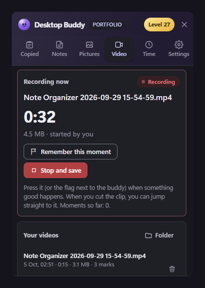
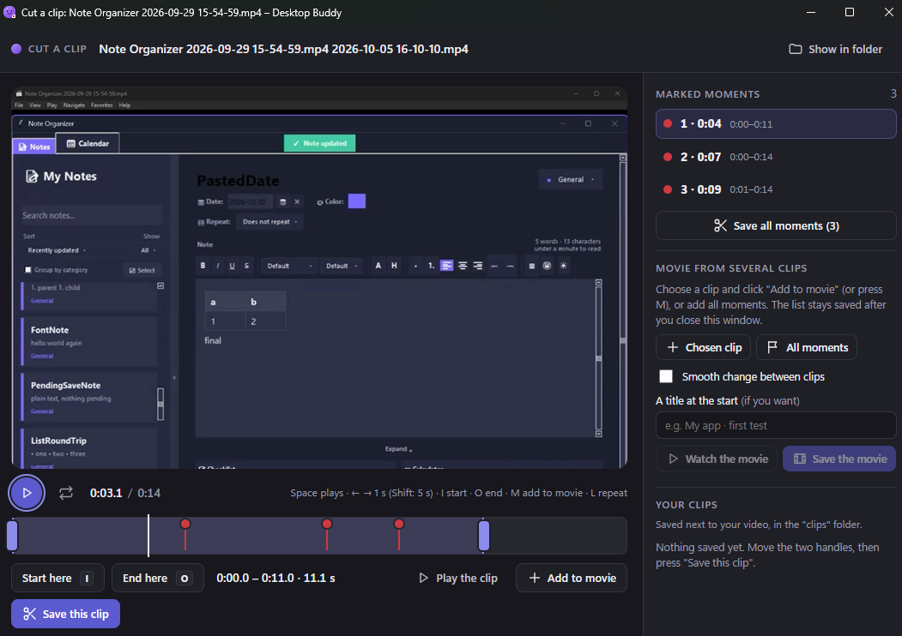
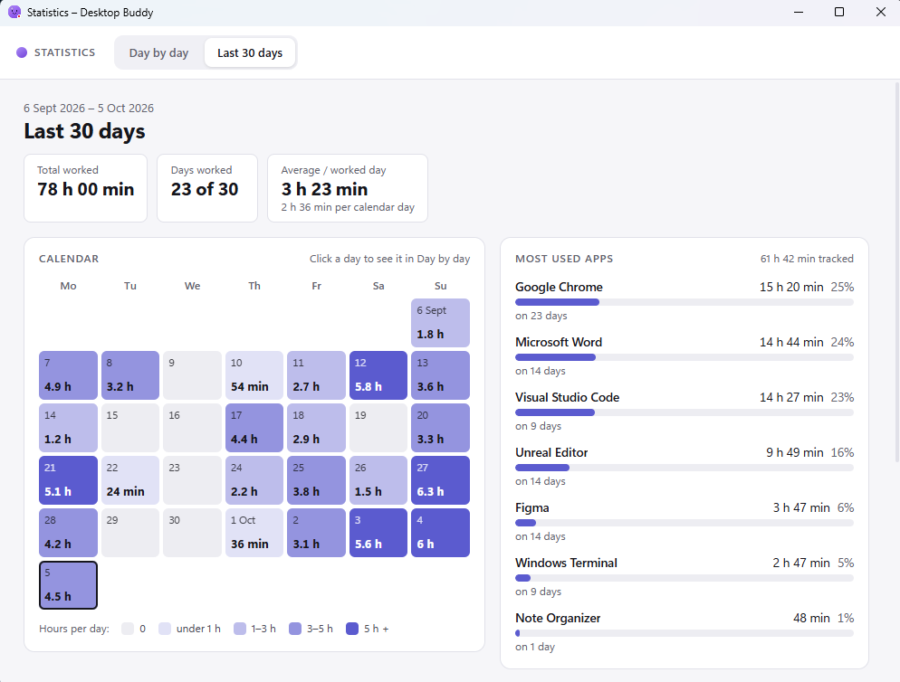
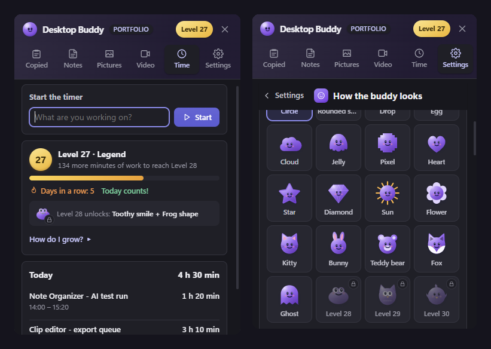
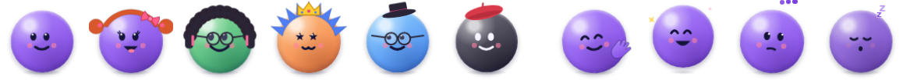
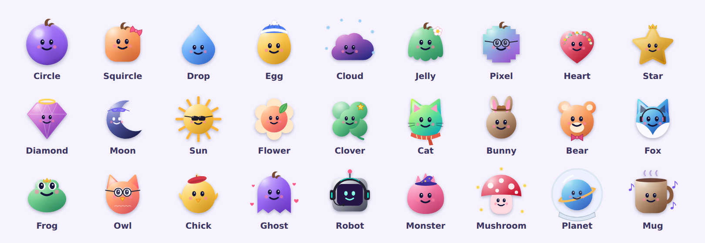
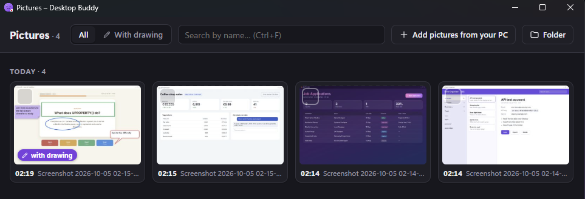
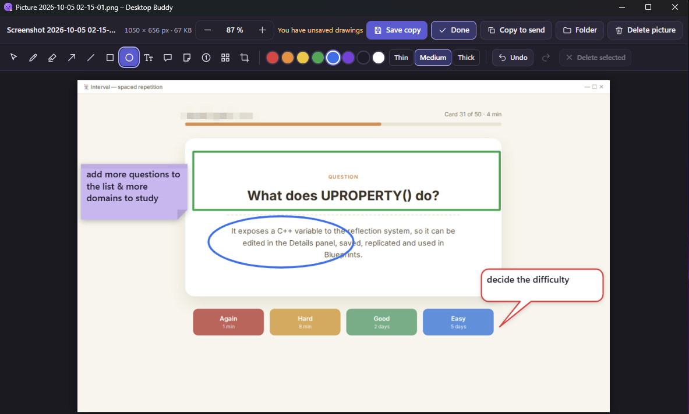
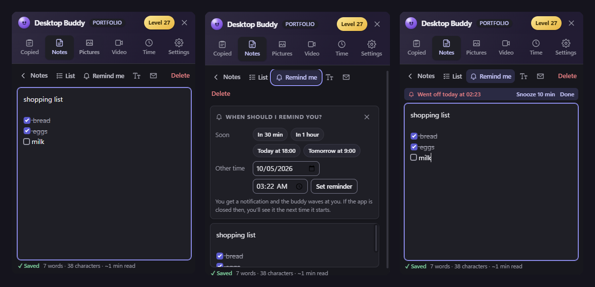

# Features

Everything Desktop Buddy does, in detail. The short version is in the [README](../README.md).

## Window recorder *(portfolio edition only)*

| | |
|---|---|
| **Records one window**, not the screen | No desktop, no notifications, **no audio**. Output is **MP4 (H.264)**, 720p / 1080p / 1440p at 30 or 60 fps. |
| **Auto-start rules** | *"Window title contains …"*, case-insensitive. Recording **starts when the window opens** and **stops when it closes**. Manual start/stop is always available too. |
| **Merges relaunches** | AI test runs close and reopen the app constantly. If a matching window reappears within **15 s** (configurable), recording **continues in the same file** instead of creating 20 tiny clips. |
| **Skip idle** *(optional)* | Pauses while nothing on screen changes (0.5–5 s threshold) and resumes on the first change. A blinking cursor doesn't count. Only the action stays. |
| **Marks** | While recording, a small **flag** appears next to the buddy: one click marks a good moment (also *Remember this moment* in the Video tab or the tray). No global shortcut, so no key is taken from the app you are testing. Marks are saved with the video and in a readable `… - marks.txt` file next to it. |
| **Crash-safe files** | Written in chunks to a `.part` file every second and renamed when done: a crash loses seconds, not the recording. |

  

## Clip editor

Open any recording with **Cut a clip** to get a player with a **timeline showing your marks**, draggable **in/out handles** (or the **I** / **O** keys), **Space** to play and arrow keys to step. **Save this clip** saves the selection; **Save all moments** creates one ~15 s clip around each marked moment in one go. Clips land in a `clips\` subfolder next to the original.

**No ffmpeg, no extra install:** the editor replays the selected range and re-records it with the browser's own `MediaRecorder`, so the installer stays the same size (see [how](ENGINEERING.md)).

**Play in a loop** (for demos and portfolio pages): the **loop** button (or **L**) makes the player repeat the whole video, the selection or the montage preview until you pause. Every finished clip and montage also has a **loop** button that opens it in its own **viewer window**, sized to the video (up to 90 % of the screen) and looping by default: **F** or double-click for full screen, **Space** to pause, **L** to toggle the loop, **Esc** to close. The control bar hides after 2 s, so it doesn't cover the clip while you present it.

**Code for a portfolio site**: an MP4 file can't loop by itself (looping is up to the player), so every MP4 clip has a **code** button. It copies a ready `<video autoplay loop muted playsinline>` tag (with width/height to avoid layout shift and an accessible label) and puts a copy of the clip with a **web-safe name** (lowercase, no spaces or diacritics) in `clips\for web\`, opened in Explorer, ready to drop into the site's `videos/` folder. Step-by-step instructions for publishing clips (looping or click-to-play) on a Netlify site, GitHub Pages and a GitHub README, written so an AI assistant can follow them: [`docs/PUBLISHING-VIDEOS.md`](PUBLISHING-VIDEOS.md).

**Smooth scrubbing**: dragging the in/out handles seeks only to the latest position and waits for the previous seek to finish, once per screen frame, so the handle follows the mouse instead of freezing. New recordings and exports have a **keyframe every second** (instead of every ~3.4 s), which makes each seek cheaper.

**Movie from several clips** (a montage): collect several ranges of one recording (**M** or *Add to movie*), reorder them, and save them as **one MP4**. *All moments* turns every marked moment into a part, merging overlapping ones so nothing plays twice: a one-click highlight reel of a test run. Optional **smooth change** (0.3 s fade through black) between parts and an optional **title card** (1.5 s). **Watch the movie** previews it in the player before exporting: parts play back to back, the title card and fades are simulated over the video, and the current part is highlighted in the list and on the timeline. The unfinished montage is saved with the recording, so closing the editor doesn't lose it.

## Focus sessions and statistics

- **Session timer**: start a work session with a title, pause, stop. A tiny **always-on-top timer** can be dragged anywhere (position is validated against the connected monitors at startup), faded or hidden.
- **Hourly notifications** of active time and an **end-of-session report**: total time, pauses and **which apps you used**, with time per app and per window title.
- **App tracking** only while a session is running (never in pause), and **everything stays on the computer**.
- **Statistics window**:
  - **Day by day**: every day with its sessions, a **timeline of the day** (pauses are the gaps) and the apps used.
  - **Last 30 days**: a **calendar heatmap**, **most used apps** and a **week-by-week comparison** (current week vs. the same days of the previous week).

Statistics, level and sessions in the screenshots come from generated demo data (`npm run demo`).

## A buddy with a personality

The buddy is a small character (round by default) that stays on top, can be dragged anywhere and remembers its position. Click opens the panel next to it; a **red dot pulses** on it while recording (in power saver it stays still).

- **Alive, not distracting**: it **waves** when the app starts, **blinks**, **follows the mouse with its eyes** (the eye shine moves too), looks **happy** when a session starts or ends and every full hour, says **"wow"** when you copy something, looks surprised while dragged, **giggles and shows a little heart when you pet it** (stroke it back and forth with the mouse, no click), and **falls asleep** after 3 minutes without a session and without mouse or keyboard (hover wakes it). One switch turns the animations off, and `prefers-reduced-motion` is respected.
- **Make it yours** (*Settings → Change how the buddy looks*): a **shape** (27, from circle to cat, frog, robot or coffee mug), 8 colors or your own, 5 eye styles, 5 mouths, cheeks, 6 hairstyles in 7 colors, and accessories (glasses, bow or flower, top hat, crown, beret or headphones: one per slot). **Random** and **Reset** included. The purple default is what tells this edition apart from the course one.

## A buddy that grows

Focused work makes the buddy level up, and levels unlock **new** looks (everything that was already in the customizer stays free):

- **1 XP per minute of active session time** (pauses don't count) plus a **streak bonus**: a day with **25+ active minutes** keeps the streak going and adds 10 XP × streak length (capped at 70/day). **Weekends off don't break the streak**, and today only counts against you once it's over.
- **Levels** follow `20 × (level − 1)^1.7` XP: level 2 after 20 minutes, level 5 after ~3.5 hours, level 10 after ~14 hours, level 25 after ~74 hours (tuned in 1.5.0 after the first curve felt too slow). Titles go from *Beginner* to *Legend*.
- **72 rewards** from level 2 to 60. Up to level 25 the original 12 (Night, Aurora, Gold and Galaxy colors, heart eyes, a star, a beanie, a wizard hat, a halo, a royal crown, sparkles, a glowing aura). Since 1.9.0 also **24 shapes** (one per level from 7 to 37: egg, cloud, heart, star, moon, sun, cat, bunny, bear, fox, frog, owl, chick, ghost, robot, mushroom, planet, mug and more), 7 colors (including a 3-color rainbow), 4 eye styles, 5 mouths, 5 hairstyles, 9 accessories (bow tie and scarf in a new neck slot, sunglasses, cowboy hat, flower wreath, gaming headset, sleep mask, astronaut helmet, a leaf) and 6 animated effects (bubbles, hearts, music notes, snow, fireflies, a rainbow). After level 37 rewards come every 2–3 levels; **level 60** is a long-term goal (~20,000 XP, about three months of 4-hour days). Circle, squircle and drop are free. Locked items show in *Personalize* with a lock and the level they need, and the main process refuses to save them early.
- **Every item works on every shape**: the face, hats, side accessories and the neck slot are re-positioned per shape (on animals the hat sits **between the ears**); shapes that already have ears, petals or rays hide the hair, and the owl and chick get a beak instead of a mouth.
- **Level-up**: the buddy jumps twice with a golden ring, you get a notification with what you unlocked, and a **Lv.** pill in the panel header opens the progress card (XP bar, streak, record, today's minutes toward the streak, next reward previewed on *your* buddy).
- It's all computed from the existing session files, so there is **no separate counter** to drift or tamper with, and your past sessions count from day one.

  

  

  

  

## Everyday tools

- **Copied (clipboard history)**: text only, search, pin, click to copy again. It **never saves API keys or tokens** (Anthropic, OpenAI, GitHub, Google, AWS, Stripe, Slack, JWT, private keys and more), and it ignores anything password managers mark as sensitive.
- **Notes**: plain-text notes with autosave, plus **text tools without AI**:
  - **Word count** under the note (words, characters, reading time), and for the selection while you select.
  - **Text transforms** (UPPERCASE, lowercase, Title Case, Sentence case) on the selection or the whole note, from the **Aa** button or right-click. Ctrl+Z undoes them.
  - **Checklists**: real checkboxes you tick with a click (or **Ctrl+Enter** / the checklist button); Enter continues the list. The list shows progress (`2/5`). Notes stay plain text, so they can still be emailed and searched.
  - **Reminders**: a bell on each note: *in 30 min*, *in an hour*, *today at 18:00*, *tomorrow at 9:00* or any date and time. You get a Windows notification and the buddy waves; reminders that passed while the app was closed show up at the next start. Snooze or mark *Done*.
  - **Clean up text**: fixed rules (double spaces, space before punctuation, missing space after a comma, `ş/ţ` with cedilla → correct `ș/ț`, extra blank lines, capital letter after a full stop) shown as a **word diff** with *Accept / Reject* before anything changes. URLs, emails, paths, numbers like `3,14`, abbreviations like `dl.` / `nr.` and `...` are left alone.
- **Quick capture, from buttons only** (right-click on the buddy, the tray menu or the **Pictures** tab; no global shortcuts, so nothing starts from the keyboard by accident):
  - **Quick note**: a small box next to the buddy; Enter saves it as a new note, Esc discards it, clicking away keeps what you typed.
  - **Screenshots**: drag an **area** (the screen freezes and dims, Esc cancels; correct at 125 % / 150 % scaling) or pick a **window** from a list with thumbnails (captured at its real size, even if other windows cover it). PNGs go to a separate `Screenshots` folder next to the recordings. The buddy and the panel are hidden for that moment so they don't end up in the picture.
  - **After each screenshot** a small card shows the picture next to the buddy, **without taking focus** (you keep typing where you were). *Copy to send* puts the image on the clipboard (paste it into Slack, Confluence, an email) and *Draw on it* opens it large; *Open*, *Show in folder* and *Delete* (to the Recycle Bin, after a second click) sit under **More**. The card closes itself after 15 seconds in simple mode (8 in full mode), but not while the mouse is on it. The **Pictures** tab shows the latest six as **thumbnails**; a click opens the large view.
  - **Screenshots gallery** (right-click on the buddy, the tray, or *See all pictures* in the Pictures tab): every screenshot grouped by day, one tile per picture (when it has a drawn-on copy you see the copy, marked **with drawing + clean picture**, and the original isn't listed twice; *Open original* shows the untouched picture), search by name, a *With drawing* filter, Ctrl / Shift-click to select several and move them to the Recycle Bin (when annotated pictures are selected you **choose each time**: keep the originals and delete only the copies, or delete both), **drag a tile into Slack, Confluence or an email** to share the file, and **drop pictures from your PC** (PNG, JPG, WebP, GIF, BMP) or use *Add pictures…* to bring them in for annotating. Nothing is imported unless you choose it.
  - **Zoom** from 5 % to **800 %** (Ctrl+wheel zooms toward the mouse, + / − / 0 = fit / 1 = 100 %, drag to pan); above 200 % pixels stay sharp instead of blurry.
  - **Drawing on pictures** (simple mode shows Arrow, Pen, Box, Text and Blur with labels and a **Done** button that saves; the rest is under **More**): pen, transparent highlighter, arrow, line, rectangle, ellipse, text, **speech bubbles** whose tail you drag onto the exact spot you're commenting, **sticky notes**, **numbered steps** (1, 2, 3… renumber themselves), **blur** (pixelates emails, names or keys) and **crop**; 8 colors, 3 sizes, select / move / resize, undo / redo, and a **right-click menu on any annotation** (colour, size, edit text, duplicate, bring to front / send to back, delete; on an empty spot: undo, redo, delete all). **The original is never changed**: *Done* / *Save copy* writes `<name> - annotated.png` next to it, and the annotations stay editable, so you can reopen the picture (or its copy) and change them later. **Cropping never loses the original either**: the large view of a drawn-on copy has a switch to the clean picture, and deleting one of the two asks whether the other goes too.
- **Time**: a timer for focus sessions; when you lock the screen (Win+L) it pauses, pauses and goes on, or keeps counting, your choice.
- **Email, send only**: send a note to **any address** (up to 5, with your recent recipients one click away), the **30-day summary**, or the **session report automatically on Stop**. It goes out through **your own mail account over SMTP** (a Gmail *app password* works), so the recipient needs nothing. **The app can't read your inbox**: IMAP was left out on purpose.
- **Settings grouped by category** (Size and moves, Window and colors, Help; under **More settings**: Copied, Time and timer, Email), each with a live summary, so nothing is more than two clicks away.
- **Simple mode and a first-run tour**: new users see only the everyday buttons (tabs Copied / Notes / Pictures / Video / Time / Settings); advanced tools sit under **More**, and a 7-step tour points at each part. Existing users keep the full view; one switch in Settings changes it, live, in every window.
- **Power saver**: on PCs with ≤ 4.5 GB RAM or 2 cores the app stops endless animations (short buddy reactions stay), polls less and suggests lighter recording defaults (Auto / On / Off in Settings).
- **Privacy notices**: if the recordings folder is synced by OneDrive, the app says so once and lets you pick another folder. Settings → Help opens the data folder and the log file (which never contains notes or copied text).
- **Light and dark theme**, a **global shortcut** (Ctrl+Shift+Space) and a **tray icon**.

  

  

  

---

## Known limitations

- **No spellcheck** (removed in 1.6.0, see [ENGINEERING.md](ENGINEERING.md)) and no grammar checking; *Clean up text* fixes spacing, punctuation and diacritics only.
- **No audio**: Windows doesn't expose per-window audio.
- A **minimized** window can't be captured (a covered one can). Windows 11 may draw a **yellow border** around the captured window.
- MP4 clip and montage export runs in **real time** (a 15 s clip takes ~15 s). There is **no GIF export** (removed in 1.6.0): at a readable size, GIFs of app windows were large and their text still looked worse than a much smaller MP4.
- **Windows only** in practice: the macOS code paths exist but haven't been tested, and there's no macOS installer.
- Not code-signed, so SmartScreen warns on first install.

## Roadmap

Planned next, one at a time:

- Signed installer and a GitHub Release for every version.
- A real-footage demo of each feature.
- Lint and CI on Windows (GitHub Actions).
- macOS: code paths exist but are untested; no installer yet.
